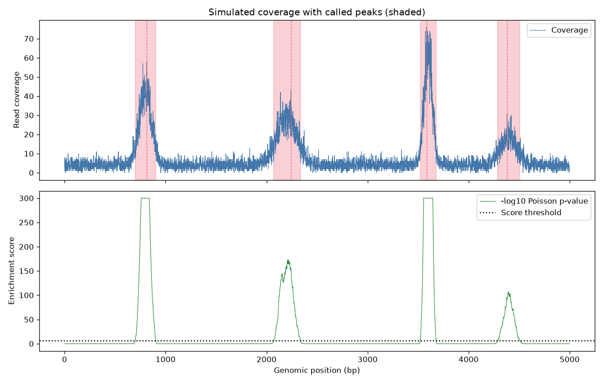

# peak-calling-from-scratch

Every peak caller you have ever used is, under the hood, a slightly fancier version of this. Strip away the file parsers, the duplicate removal, the shifting models, and you are left with one question: is this stretch of genome more covered than you would expect by chance? This repo answers that question in a few hundred lines of plain Python so you actually understand what MACS2 is doing for you.

## Demo Output



The figure above was produced from simulated read-coverage data by `demo.py`, showing the coverage track, the Poisson threshold, and the called peak boundaries.

## Why This Exists

People treat peak calling as a black box. You run a tool, you get a BED file, you move on. Then a reviewer asks why your weak peaks vanished when you changed `-q` and you have no answer. Building the thing yourself fixes that.

The core idea is embarrassingly simple:

1. Slide a window across the coverage track.
2. Model the local or global background as a Poisson process.
3. For each window, compute the probability of seeing at least this many reads under background.
4. Keep windows that clear a significance threshold, then merge adjacent survivors into peaks.

## When NOT to Use This

| Situation | Use this repo? | Use instead |
|-----------|----------------|-------------|
| Learning how peak calling works | Yes | - |
| Prototyping a custom enrichment metric | Yes | - |
| Production ChIP-seq with controls | No | MACS2/MACS3 |
| Broad domains (H3K27me3) | No | SICER/epic2 |
| ATAC-seq with Tn5 shift correction | No | MACS2 with shift options |

If you need a defensible result for a paper, use a battle-tested tool. If you need to understand what that tool is deciding, read this code.

## The Uncomfortable Truth

A single global Poisson background is almost always wrong. Real coverage is overdispersed, biased by mappability, GC content, and copy number. That is why serious callers use a local lambda or a negative binomial. This repo uses a local background estimate to soften the problem, but you should never mistake a clean demo plot for a solved problem.

## Usage

```bash
pip install -r requirements.txt
python peak_caller.py --help
python demo.py
```

`peak_caller.py` exposes `call_peaks(coverage, ...)` which takes a 1D numpy array and returns a list of peak intervals with scores.

## How the Score Works

For each window we compute the local background rate from a wider flanking region, then evaluate the Poisson survival function (probability of observing at least the windowed count). We convert that p-value to a `-log10` score. Windows above the score threshold are merged if they are close enough, and each merged peak keeps its summit (the position of maximum coverage).

The decision you actually tune:

| Parameter | Lower it when... | Raise it when... |
|-----------|------------------|------------------|
| `score_threshold` | you are missing real peaks | you have too many false peaks |
| `window` | peaks are narrow and sharp | peaks are broad and noisy |
| `min_gap` | peaks are being over-merged | you want fewer, fatter peaks |

## Further Reading

- "Model-based Analysis of ChIP-Seq (MACS)" by Yong Zhang, Tao Liu, et al.
- "Computational methodology for ChIP-seq analysis" by Qi Wei and Ji-Hyun Park.
- "Statistical Methods in Bioinformatics" by Warren Ewens and Gregory Grant.
